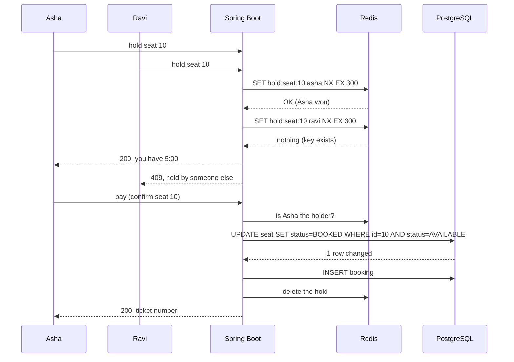

# Tatkal Booking: no two people get the same seat

At 10 am on Tatkal day, thousands of people click the same seat at the same moment. This project is a small train-seat booking system that answers one question:

> **What happens when two requests for the same seat arrive together?**

It has three versions of "book a seat". A load test sends **1,000 people at one seat at the same instant** to each version and counts what really ends up in the database.

| Version | How it works | What the load test shows |
|---|---|---|
| **v1 Naive** | Read the seat, if it is free, save the booking | **Double-books.** The same seat is sold to many people. |
| **v2 Row lock** | Same, but the database locks the seat row while one person is booking it (`SELECT ... FOR UPDATE`) | Correct every time. Requests for one seat are served one by one. |
| **v3 Redis hold** | Like the real site: *hold* the seat for 5 minutes, then *pay* to confirm. Redis decides who gets the hold. | Correct every time, and faster than the row lock when everyone wants the same seat. |

Built with Java 21, Spring Boot, PostgreSQL, Redis, React, Docker and GitHub Actions.

## The results

1,000 users, all fired at the same moment. Each row is the median of 5 races, after one warm-up race.
"Seats sold twice" is the **worst** of the 5 races. The last column is the median requests per second, with the slowest and fastest race in brackets.

| Version | Scenario | Seats sold twice | Booking rows | p50 ms | p95 ms | p99 ms | Requests/s (min-max) |
|---|---|---|---|---|---|---|---|
| v1 Naive | same-seat | 1 | 18 | 798 | 1351 | 1503 | 499 (439-637) |
| v2 Row lock | same-seat | 0 | 1 | 1226 | 2597 | 2743 | 350 (269-450) |
| v3 Redis hold | same-seat | 0 | 1 | 513 | 1309 | 1405 | 575 (545-667) |
| v1 Naive | spread | 22 | 99 | 762 | 1629 | 1806 | 541 (465-588) |
| v2 Row lock | spread | 0 | 72 | 601 | 1289 | 1450 | 523 (455-572) |
| v3 Redis hold | spread | 0 | 72 | 1035 | 1757 | 2115 | 420 (329-475) |

- **same-seat**: all 1,000 people want seat 1. The right answer is **1** booking.
- **spread**: each person picks one of the 72 seats. The right answer is **72** bookings.

**Correctness (this result is solid).** Version 1 sold the one seat 18 times (median; between 4 and 20 times in the 8 same-seat races I ran over two sessions). In the spread race it sold 99 tickets for 72 seats, with 7 to 22 seats sold twice. Versions 2 and 3 sold exactly 1 and exactly 72 in every one of their 16 races each: zero double-bookings.

**Speed (treat as rough).**
- When everyone wants the same seat, the Redis hold served more requests per second than the row lock in every race of both sessions: 575 against 350 in the table above (about 1.6x), and about 2.5x in my first, busier session.
- When people spread over the seats, the three versions were close and the order changed between sessions. In the table above v3 is the slowest of the three. I have not investigated why.
- v2 and v3 had no request errors. Two v1 spread races had connection errors (97 and 42 of 1,000), where the operating system refused some of the simultaneous connections.

**How to read the numbers honestly.** Everything ran on one laptop: the load test, the Spring Boot app, PostgreSQL and Redis (the last two inside WSL). The same test gave roughly 3x higher requests per second in the second session than in the first, because the laptop was busier the first time. So absolute speed is not stable. Compare the versions within one session, and do not compare them with a real production server. Raw data: [`docs/results/results.csv`](docs/results/results.csv).

**Why does v1 never sell more than about 20 copies?** The app has 20 database connections. Only requests that are *in the middle of booking at the same moment* can collide, and at most 20 can be at that point at once. The same-seat counts I saw were 4, 6, 11, 17, 18, 18, 20 and 20.

## Read the code in this order

Each file is short and has comments written for a learner.

1. [`V1__schema.sql`](backend/src/main/resources/db/migration/V1__schema.sql): the two tables. Note that `booking.seat_id` is **not** unique, on purpose.
2. [`NaiveBookingService`](backend/src/main/java/com/tatkal/booking/NaiveBookingService.java): version 1, and the comment marking **the gap** where the bug lives.
3. [`LockedBookingService`](backend/src/main/java/com/tatkal/booking/LockedBookingService.java) and [`SeatRepository`](backend/src/main/java/com/tatkal/seat/SeatRepository.java): version 2. The only change is one locked read.
4. [`HoldBookingService`](backend/src/main/java/com/tatkal/booking/HoldBookingService.java): version 3, with the one Redis command that does the job (`setIfAbsent` = `SET key value NX EX 300`).
5. [`LoadTest.java`](loadtest/LoadTest.java): how 1,000 people are fired at the same instant (a "start gun" latch plus virtual threads).
6. Tests: [`LockedBookingConcurrencyTest`](backend/src/test/java/com/tatkal/LockedBookingConcurrencyTest.java) and [`HoldBookingServiceTest`](backend/src/test/java/com/tatkal/HoldBookingServiceTest.java).
7. [`frontend/src/App.jsx`](frontend/src/App.jsx): the seat map, the hold countdown and the pay button.

## How version 3 works



If Asha never pays, Redis deletes the key after 5 minutes and the seat is free for everyone again.

## Run it yourself

You need Java 21, Node 22, PostgreSQL 16 and Redis 7. The simplest way is Docker:

```
docker compose up --build
```

Then open http://localhost. Open the page in two browser tabs: each tab is a different person, so you can watch one hold a seat while the other sees it as taken.

Without Docker (what I did on Windows, with PostgreSQL and Redis inside WSL):

```
# one-time: create the database user and databases
sudo -u postgres psql -c "CREATE USER tatkal WITH PASSWORD 'tatkal' CREATEDB;" -c "CREATE DATABASE tatkal OWNER tatkal;" -c "CREATE DATABASE tatkal_test OWNER tatkal;"

cd backend && ./mvnw spring-boot:run        # API on http://localhost:8080 (Swagger at /swagger-ui.html)
cd frontend && npm install && npm run dev   # page on http://localhost:5173
```

Run the tests with `cd backend && ./mvnw verify`.

Run the race (with the backend running):

```
java loadtest/LoadTest.java http://localhost:8080 v1 1000 same-seat
java loadtest/LoadTest.java http://localhost:8080 v2 1000 same-seat
java loadtest/LoadTest.java http://localhost:8080 v3 1000 same-seat
```

Or the whole experiment (1 warm-up + 3 recorded races for every version and scenario), then the tables:

```
bash loadtest/run-all.sh
node loadtest/summarize.mjs
```

## CI

GitHub Actions runs three jobs on every push: backend tests against real PostgreSQL and Redis, the frontend build, and a docker-compose smoke test that starts the whole system and races 200 users. **The build fails if version 2 or version 3 ever sells a seat twice.**

## Deploy

[`deploy/aws-ec2.md`](deploy/aws-ec2.md) puts the whole system on one AWS server. [`deploy/bootstrap.sh`](deploy/bootstrap.sh) is pasted into the server's "user data" box at launch, and the server installs Docker, builds the app and starts it by itself. The public demo frees all seats every 15 minutes, and the admin endpoints used by the load test are not reachable from the internet.

## Interview talking points

**"How do you stop two people booking the same seat?"** Walk through the three versions in the table. The answer is: make "check if free" and "mark as taken" one indivisible step.

- **The bug has a name.** v1 is a *check-then-act race condition*. Between "is it free?" and "mark it booked", other requests slip in.
- **Why not `synchronized` in Java?** It only protects one running copy of the app. With two servers behind a load balancer, each has its own lock and both sell the seat. The lock has to live somewhere shared: the database (v2) or Redis (v3).
- **v2 trade-off.** Correct and simple, but everyone wanting the same seat waits in a queue, holding a database connection while they wait. That is a risk when thousands arrive.
- **v3 trade-off.** Losers are turned away in one fast Redis call without touching the database. The cost is an extra moving part, and a hold that can expire.
- **Redis is atomic.** It runs one command at a time, so `SET NX` has exactly one winner out of 1,000.
- **What if Redis loses the holds (restart or crash)?** Confirming still runs `UPDATE ... WHERE status = 'AVAILABLE'`, so the database refuses a second booking of the same seat. Redis is the fast front door; PostgreSQL stays the final judge.
- **The pool-size observation.** v1 never sold more than 20 copies in any race because the pool has 20 connections. A good example of reading your own results.

**What I would add in production** (deliberately left out to keep this readable):
- `UNIQUE (seat_id)` on `booking`, so even v1 would fail loudly instead of silently double-booking.
- Deleting the hold only if it still belongs to the confirming user, as one atomic Redis step (a small Lua script). Today `confirm` checks the holder and then deletes in two steps.
- Optimistic locking (`@Version` on `Seat`) as a fourth strategy: no lock, but losers must retry.
- Real payment, login, many trains and dates, and a way for a user to release a hold early.

**Known limits.** One train, one coach, one date. The seat map refreshes by polling every 2 seconds, not live push. Latency figures come from a single laptop (see above).
